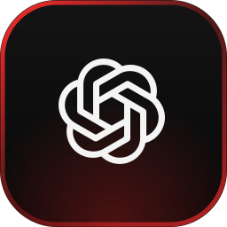
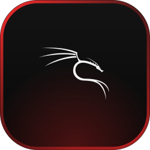
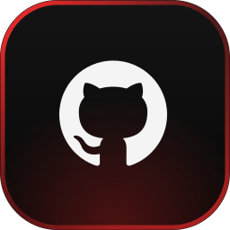
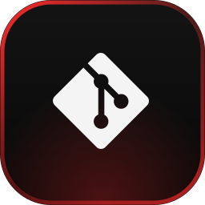
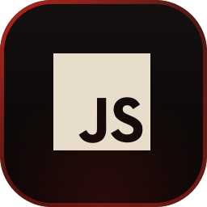
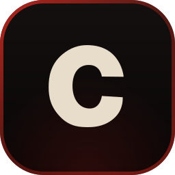
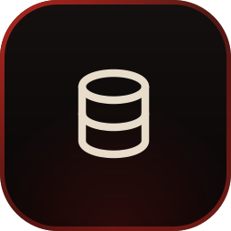

  

  

<h1 align="center">Hey, I'm Hamza </h1>

  <i>Software Engineer | Web Development & Cybersecurity Enthusiast</i>

  
  
  
  
  

---

> *"Architecture, product logic, and security are mine. AI helps with the rest."*

## ## About Me

I'm a Computer Science student interested in understanding how software works, from code and databases to operating systems and networks.

I enjoy experimenting with different technologies, building projects, and learning by solving real problems. My interests span web development, backend engineering, Linux, cybersecurity, and OSINT.

I use AI tools as part of my development workflow, but my main goal is to understand what I'm building, explore better approaches, and keep improving my technical skills.

This GitHub is where I document my projects, experiments, and progress as I learn.
## ## Tech Stack

  
  &nbsp;&nbsp;
  
  &nbsp;&nbsp;
  
  &nbsp;&nbsp;
  
  &nbsp;&nbsp;
  
  &nbsp;&nbsp;
  
  &nbsp;&nbsp;
  

  
  &nbsp;&nbsp;
  
  &nbsp;&nbsp;
  
  &nbsp;&nbsp;
  
  &nbsp;&nbsp;
  
  &nbsp;&nbsp;
  
  &nbsp;&nbsp;
  

**Languages:** English · Arabic · French
## ## Connect With Me!

  
  &nbsp;&nbsp;
  
  &nbsp;&nbsp;
  

Message me. I'll reply in 5 minutes.

## ## Stats

  
  

---

## Let's Work Together

Open to freelance projects and software or security internships. Send me a message through any of the links above.

  

<i>Life doesn't get easier, you just get better.</i>
